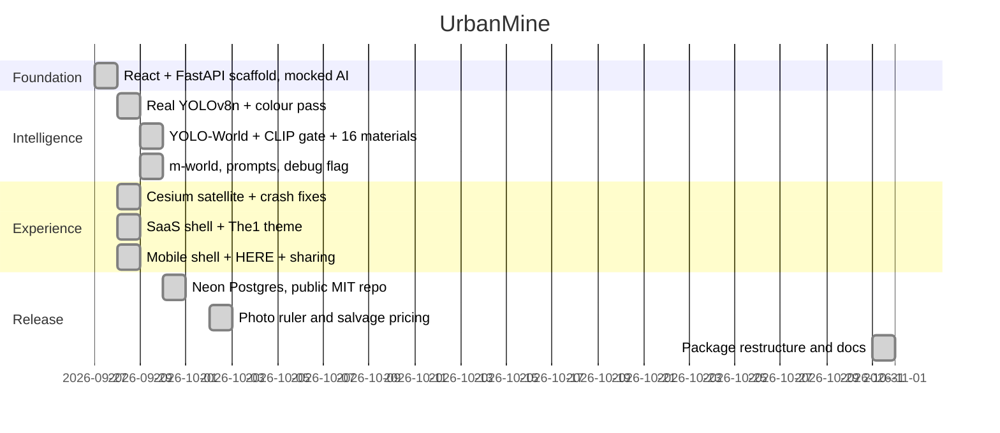

# UrbanMine — the codebase, module by module

Read this when you need to change code rather than run it. For running, see
[`../README.md`](../README.md). For why each choice was made and what it cost, see
[`DECISIONS.md`](DECISIONS.md). For hosts and deploy commands, see
[`DEPLOY.md`](DEPLOY.md).

## 1. Big picture

A contractor photographs a demolition site. The AI names the recoverable
materials with quantity, condition and a salvage price. One click turns a
detection into a marketplace listing. Buyers search and match by material,
quantity, condition and distance, then send a request. The contractor accepts or
declines.

| Layer | Choice | What it buys |
|---|---|---|
| Frontend | React 18 + Vite 5 | Instant HMR, a dependency-free static build |
| Backend | Python + FastAPI | The AI ecosystem lives in Python; the CRUD layer stays thin |
| AI | YOLO-World-m + YOLOv8n + colour pass + CLIP gate | Zero-shot materials, no training set needed |
| Store | `data.json` or Neon Postgres, same interface | Runs with no database, ships with one |
| Maps | CesiumJS satellite, HERE → Nominatim | Works keyless; keys only upgrade it |
| Hosting | Vercel frontend + Vercel container backend | One public URL, no CORS |

## 2. Source map

Approximate sizes, so you know what you are opening.

```
urbanmine/
  README.md                          run it, find it
  AGENTS.md                          rules for editing
  docs/DECISIONS.md                  why, and where problems were solved
  docs/DEPLOY.md                     hosts, aliases, commands
  docs/PROJECT-FULLSTACK.md          this file
  render.yaml                        Render blueprint, docker, 2GB
  docker-compose.yml                 optional local Postgres
  scripts/
    publish-here.py                  static publish: manifest → PUT → finalize
    publish-pick.py                  publish several times, keep the best slug
    deploy-space.sh                  clean copy of backend/ to a HF Space
  backend/
    app/
      main.py                ~365  routes only
      schemas.py              ~60  request and response shapes
      core/
        catalog.py           ~140  16 materials, prices, CO2, prompts, gates
        scoring.py            ~45  haversine, qty_for, match_score
      ai/
        vision.py            ~490  all model loading and the four passes
      storage/
        store.py             ~125  Postgres or data.json, plus image bytes
        images.py             ~35  the 1600px copy and the 480px thumbnail
    tests/                         50 tests, models stubbed
    data.json                      fallback store, empty until someone publishes
    requirements.txt               fastapi, uvicorn, pydantic, ultralytics,
                                   pillow, numpy, transformers, clip-anytorch,
                                   psycopg[binary]
    Dockerfile                     bakes weights, exposes PORT
    vercel.json                    framework: container
  frontend/
    index.html                     Cesium 1.119 CDN + fonts
    vite.config.js                 :5173, /api + /uploads proxy, HTTPS mode
    vercel.json                    /api + /uploads rewrites to the backend alias
    package.json                   react, react-dom, gsap, exifr
    src/
      main.jsx                     React root
      App.jsx                ~980  shell + five panels + API consumers
      components/LocationPicker.jsx ~295  coordinate-free picker and mini globe
      components/MeasureModal.jsx   ~185  ruler on the photo
      lib/measureMath.js             ~80  mm/inches/feet and measured quantity
      lib/cesium.js                 ~130  token, createViewer, flyTo, setPins
      styles/styles.css             ~180  The1 tokens, flat cards, a11y
```

## 3. Backend

### Routes (`app/main.py`)

Thin by rule: parse the input, call one module function, return. No AI and no
maths in a route.

| Method + path | In | Out |
|---|---|---|
| `GET /` | — | name, docs path, health path |
| `GET /api/health` | — | `status`, `yolo`, `world`, `store`, `listings`, `requests` |
| `POST /api/analyze` | multipart `file`, `lat`, `lng`, `address`, `debug?` | `image_url`, `thumb_url`, `detections[]`, `non_construction[]`, `is_construction_site`, `model`, `verification` |
| `POST /api/listings` | material, quantity, unit?, condition?, price?, coords, contractor, image fields | the created listing, 8-char id |
| `GET /api/listings` | material?, condition?, q?, lat?, lng?, max_distance_km=100 | active listings, nearest first, with `distance_km` |
| `GET/PATCH/DELETE /api/listings/{id}` | patch: quantity?, condition?, price?, status? | one listing, or `{deleted: id}` |
| `POST /api/match` | material, quantity=100, lat, lng, condition?, max_distance_km=50 | `{results: [...]}`, top 20 by `match_score` |
| `POST /api/requests` | listing_id, buyer_name, buyer_type?, quantity?, message? | the request, status `pending` |
| `GET /api/requests` | — | all requests, newest first |
| `PATCH /api/requests/{id}` | status | updated request |
| `GET /api/materials` | — | all 16 materials, drives the dropdowns |
| `GET /uploads/{fid}` | — | the stored photo: disk first, then Postgres |

404s are `{"detail": "..."}`. Analyze never throws at the client: a photo over
25MB or a file that is not really an image comes back as `model: "rejected"` with
an `error` string, so the UI always has something to render.

`DELETE /api/listings/{id}` removes the photos too, but only files no other
listing still references — two listings can share one photo.

### Detection pipeline (`app/ai/vision.py`)

1. Downscale to 1280px for the models. The original is stored untouched.
2. YOLO-World-m on the descriptive prompt list at confidence 0.12, and YOLOv8n on
   COCO, in parallel.
3. A numpy colour and texture pass for bulk coverage, fabric detection and
   contrast-based condition. Suppressed on fabric or household frames.
4. CLIP verifies every World box and the full frame at a gate of 0.60. Strong COCO
   boxes at 0.50 or above are trusted without a second opinion. It fails open.
5. Confidences normalise to shares that add to 100%, sorted high to low.

The site verdict is kept YOLO evidence, or a passing frame with at least 20%
visual coverage. A Concrete fallback fires only on construction-looking frames
where nothing was found, and is labelled a guess.

Models are loaded lazily. Importing the module is fast; the first photo is slow.
Never import a model at module top level — the test suite depends on that.

`POST /api/analyze?debug=1` (or `debug=true`) returns `world_raw`, `coco_raw`,
`clip_frame_p`, `rejected`, and `fallback_used` from `_last_debug`.

### Maths (`app/core/scoring.py`)

Pure, no I/O, which is why it is the seam the tests pin.

- `haversine_km` — same result as `ST_Distance(geography)/1000`, so rankings
  survive a move to PostGIS.
- `qty_for` — coverage × base quantity. Never random, never hardcoded.
- `match_score` — material 40, quantity 25, distance 20 (linear to zero at 50km),
  condition 15.

### Data (`app/core/catalog.py`)

`MATERIAL_META` holds the 16 materials with unit, salvage price, CO2 factor and
icon. `CONDITION_SCORES`, `FULL_QTY`, the detection prompt lists, the hard
negatives, the COCO mapping and the CLIP threshold live here too. Data only — if
you are computing something in this file, it belongs in `scoring.py`.

### Storage (`app/storage/`)

`store.py` exposes `load_db()`, `save_db(db)`, and the image trio
`save_image`/`load_image`/`delete_image`. It checks `DATABASE_URL` at import. With
it, state is one JSONB row in `urbanmine_state` and photos are rows in
`urbanmine_images`. Without it, state is `data.json` and photos are files in
`backend/uploads/`.

`DATA_FILE` and `UPLOAD_DIR` are both overridable by env, which is how the tests
avoid the real files.

`images.py` re-encodes any accepted image as a bounded JPEG: EXIF rotation
applied, transparency flattened onto white rather than black, never upscaled.

## 4. Frontend

`App.jsx` is the shell — desktop sidebar at ≥900px, bottom tabs below — plus five
panels: Upload, Marketplace, Smart Match, Requests, Impact.

- **Upload** — dropzone and camera snap, EXIF GPS via exifr, canvas shrink to a
  1600px JPEG, auto-analyze with a visible checklist, editable detections,
  publish.
- **Marketplace** — filters, request buttons, globe pins, and a two-tap Remove
  (no `confirm()` popup); reloads when the buyer point moves.
- **Smart Match** — material, quantity, condition, radius in, ranked rows with
  score dials out.
- **Requests** — accept and decline.
- **Impact** — four cards and the maths behind them.

`components/LocationPicker.jsx` means nobody types coordinates: address search
(HERE first, Nominatim fallback), 12 presets, device GPS, map tap, and a draggable
pin. Every move reverse-geocodes.

`components/MeasureModal.jsx` is the ruler. Set a reference object, draw the line,
and `lib/measureMath.js` turns pixels into a real size, which then replaces the
coverage guess for that material.

`lib/cesium.js` owns `createViewer`, `flyTo` and `setPins`, with ion imagery when a
token exists and keyless Esri satellite when it does not. Layers are attached
through async factories because Cesium 1.119 ignores constructor imagery options.

`API = VITE_API_BASE || ''`. In dev the Vite proxy handles it; a share build bakes
the tunnel URL in.

## 5. Testing

```bash
cd backend
python -m unittest discover -s tests -v
```

50 tests, stdlib `unittest`, no model downloads, under a second. The AI is stubbed
so a green run proves routes, scoring, sizing and storage — not model accuracy.
`test_store.py` and `test_listing_delete.py` point `DATA_FILE` at temp
directories, so the real `data.json` is never touched.

## 6. Data flows

**Upload to listing:** photo → EXIF GPS or picker → shrink → analyze → edit →
confirm → live in Marketplace and matchable.

**Match:** buyer need (material, quantity, point, condition, radius) → scored rows
with `distance_km`.

**Request:** buyer identity + listing → `pending` → contractor accepts or
declines.

**Share build:** tunnel the backend → build with `VITE_API_BASE` → publish
`frontend/dist` → record the slug. Anonymous slugs are immutable and a restarted
tunnel breaks the baked address, which is why localhost is the reliable path.

## 7. Build timeline



## 8. Known edges

- `urbanmine_state` is one row: last write wins under concurrency.
- Photos live in Postgres, so the database grows with photo volume.
- Impact CO2 factors are estimates, not LCA data.
- No auth: requests carry a typed name, nothing more.
- Cesium is a CDN dependency; if it fails to load, the globes are dark and the
  pickers still work.
